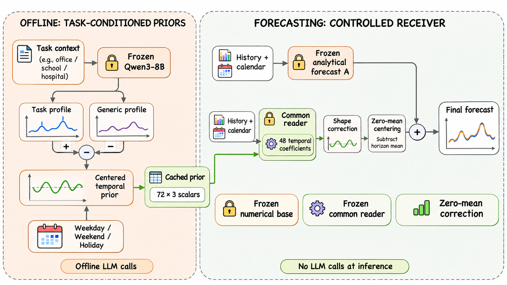

# ChronoGeom

**ChronoGeom: Distilling Task-Conditioned Temporal Priors into Minimal Forecasters**

KDD 2027 · Under review

[Project page](https://joss0623.github.io/projects/chronogeom/) · [Research homepage](https://joss0623.github.io/)

[Paper](paper/manuscript.pdf)

## Overview

Study the transfer of task-conditioned temporal priors from language models into compact forecasting receivers, separating temporal assignment from receiver learning.

## Model overview



The numerical base and common reader are frozen; only 48 temporal input coefficients are adapted. The LLM supplies cached priors offline and is not called at forecasting inference.

[Original manuscript diagram](assets/model-original.png)

## Research focus

- Temporal priors
- Knowledge transfer
- Lightweight forecasting

## Implementation

The `code/` directory contains the available research implementation snapshot. Main entry points:

- [`code/models/ChronoGeomTimeBase.py`](code/models/ChronoGeomTimeBase.py)
- [`code/layers/ChronoGeomTimeBaseOfficial.py`](code/layers/ChronoGeomTimeBaseOfficial.py)
- [`code/run.py`](code/run.py)

Framework modules, dataset readers, and supporting experiments are kept with the model. Prepare the required datasets and pretrained language-model weights separately; these are not bundled with the code. Dataset locations and experiment defaults in the original scripts need to be set for your environment.

Install PyTorch for your hardware, then install the recorded dependencies:

```bash
cd code
pip install -r requirements.txt
```

Inspect the available training arguments before configuring your dataset:

```bash
cd code
python run.py --help
```

## Snapshot and verification

`release-manifest.json` records the SHA-256 of each released source file. This release was checked for Python syntax and obvious embedded credentials; it has not been retrained or certified to reproduce every paper table on a new machine.

## Acknowledgments and license

The implementation builds on existing forecasting research libraries. Original license notices are retained inside `code/`. Upstream sources include [Time-Series-Library](https://github.com/thuml/Time-Series-Library); the numerical backbone follows the TimeBase implementation recorded in the released sources. The paper and figures retain their respective authors' rights.
